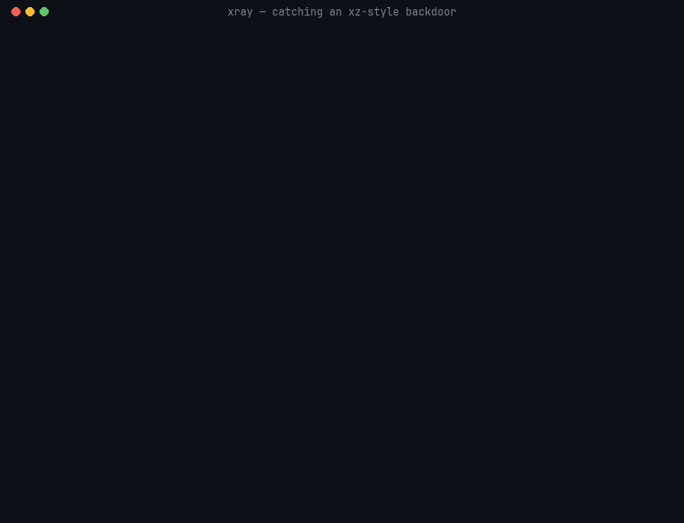

# XRAY

**Read the code of any Linux command — its files, functions and call graph — and prove what it can do.**

Point XRAY at a command and it shows you the code behind it: which language it is written in, which source files it was built from, every function with its file and line, the function's source, and which function calls which. That works for compiled programs (C, C++, Rust, Go) using the debug information and build data the binary and your distribution already publish, and for scripts (shell, Python, Perl, Ruby, JavaScript, TypeScript, Lua) read directly.

```sh
xray rg --code                        # ripgrep: 52 source files, 21 crates, the Rust standard library
xray rg --code core/main.rs           # the functions in one file, then the file
xray rg --code rg::main               # one function's source
xray rg --callgraph rg::search        # what it calls and what calls it, each with file:line
xray gh --code main.main              # Go, source from the module proxy at the exact version
xray xdg-mime --callgraph             # shell: functions, the commands each one runs
```

Then XRAY answers what the code can do, with proof: which commands a script runs and on which line, which libraries a binary loads and why the loader picks them, what a real run read, wrote and connected to. It writes that down as a reviewable capability contract, checks the program against it, enforces it with Landlock (no root), and shrinks it to what a workload provably needs. Across package versions it shows what software newly became able to do.

```sh
xray inspect xdg-open                 # everything it reaches, with the proof for every link
xray why curl libssl                  # the chain from a command to a library or package
xray contract generate jq --trace -o jq.contract -- . data.json
xray contract enforce jq.contract -- . data.json
xray drift old.pkg.tar.zst new.pkg.tar.zst
xray taint ./install.sh               # untrusted input reaching code, across shell and Python
```

XRAY never claims a program is safe: every report lists its blind spots, and every link says how it was found — observed in a run, declared by metadata, inferred from code, or guessed.



## Install

Requires Python 3.10 or newer. The Python package has no third-party runtime dependencies. The package is named `xray-trust`; the command it installs is `xray`.

```sh
pipx install xray-trust    # or: python -m pip install xray-trust
xray --help
```

From a checkout: `python -m pip install .`

Install test dependencies and run the full suite:

```sh
python -m pip install '.[test]'
python -m pytest
```

## Quick start

```sh
xray
xray pytest
xray pytest --report
xray pytest --inspect --md > pytest.md
xray pytest --chain
xray pytest --graph-json > pytest-graph.json
xray pytest --html > pytest-graph.html
xray ls --code
xray ls --code main
xray inspect xdg-open
xray why xdg-open glibc
xray scan
xray reach liblzma
xray contract generate jq -o jq.contract
```

Running `xray` by itself reads XRAY's own CLI source and suggests follow-up commands. Running `xray <command>` gives that command's overview and suggests code, calls, chains, dependency, cycle, path, and JSON queries. For compiled commands, `xray <command> --code` gives a code map: every function with its readable name, source file and line, grouped into the program's own files, its dependencies (Rust crates) and the standard library. `--code <file>` lists the functions a file defines and shows the file; `--code <function>` shows that function's source. This works for C, C++ and Rust (any language with DWARF line information), from the binary's own debug information or the debug file a debuginfod server has for its build ID; Rust dependency source comes from the crate's crates.io archive and Rust standard library source from the matching `rust-src`. On Debian, where the debuginfod server has no source, it comes from sources.debian.org at the package's exact version, Debian's patches included. Go programs need no debug file: every Go binary carries the runtime's function table (`.gopclntab`) and its build information, so names, files and lines come from the binary itself, dependency and main-module source from the Go module proxy at the exact versions, and standard library source from the Go repository at the exact release. Programs with names but no line information get their functions grouped by namespace, and `--code NAME` searches the upstream source their pacman package was built from (the archive named in Arch's `.SRCINFO`, checksum verified) for that function by name — a labelled guess, since patches and build options can differ (`xray Hyprland --code CHyprCtl::getReply`).

```
xray rg --code                         # 52 program files, 21 crates, the Rust standard library
xray rg --code core/main.rs            # the functions in main.rs, then the file
xray rg --code rg::main                # ripgrep's main, from its source
xray btop --code clean_quit            # C++
xray rg --callgraph rg::search         # what it calls and what calls it, with files and lines
xray gh --code main.main               # Go, source from the module proxy
xray fzf --callgraph main.main         # Go call graph
xray xdg-mime --callgraph defapp_generic   # shell: functions it calls, commands it runs, who calls it
xray aclocal --callgraph               # Perl, Ruby, JavaScript, TypeScript, Lua: calls found by name
```

## Evidence graph: `inspect`, `why`, `scan` and `reach`

`xray inspect <command>` follows everything a command reaches and records the proof for every link: how it was found, where (file and line), and how strong that proof is. It follows:

- shell scripts, read with a full parser (quoting, every expansion, here-documents, `case`, functions, arrays): the commands they run and the files they source, including commands inside `$(...)`, unquoted here-documents, `trap` strings, `sh -c` strings, literal `eval` and wrappers such as `sudo` and `find -exec`;
- Python, Perl, Ruby, JavaScript, TypeScript and Lua imports, and C `#include`s;
- commands Python starts (`subprocess`, `os.system`, `os.exec*`, …, with shell strings parsed) and literal command starts in Ruby, Node and Lua;
- shebang and ELF interpreters, and the shared libraries ELF files need, resolved in the dynamic loader's order: `DT_RPATH`, `LD_LIBRARY_PATH`, `DT_RUNPATH`, the ldconfig cache for the right word size, the default directories, with `$ORIGIN` expanded;
- the package that owns each file.

| Basis | Meaning |
| --- | --- |
| observed | seen in a real run (`--trace`) |
| declared | stated by metadata the system acts on (shebang, ELF `DT_NEEDED`, ELF dlopen metadata notes, package database) |
| inferred | read from code, then resolved the way this machine would resolve it |
| guessed | a resolution XRAY can't stand behind: a PATH lookup in a script that changes PATH, or a command run through a variable the script only sets to fixed values |

"Worth a look" lists findings with evidence, such as an empty, relative or world-writable `RPATH`/`RUNPATH` entry that would let another user plant a library.

`xray inspect <command> --html > graph.html` writes the evidence graph as one self-contained interactive page: columns by steps from the program, edges styled by basis (observed, declared, inferred, guessed), and a side panel with the evidence for every link into and out of the selected node and its strongest path from the program. Add `--trace -- ARGS` to include an observed run; `graph.html#node=NAME` opens with a node selected.

`xray inspect <command> --sbom cyclonedx` (or `spdx`) writes a bill of materials of what the program actually reaches on this machine: every file with its SHA-256 (and SHA-1 for SPDX), the owning packages with package URLs, and the dependency edges, each carrying XRAY's link kind and basis. The output validates against the CycloneDX 1.6 schema and with the SPDX tools.

`xray inspect <command> --tree` prints the whole graph as a tree with the basis and line of every link; it supersedes `--chain` and `--launch`, which remain for compatibility.

`xray why <command> <target>` prints the shortest proof chains from the command to a file, command name, library (`libssl` or `libssl.so.3`) or package; each chain is as strong as its weakest link, and the exit status is 1 when no chain is found. `inspect --trace -- <args>` runs the command and lists files it executed or opened that static reading did not predict.

`xray scan [DIR ...]` reads every executable on PATH (or in the given directories) into an evidence store in `~/.cache/xray` (`$XRAY_CACHE_DIR` overrides it). What each file reaches is stored with its size, times, inode and SHA-256, and with a machine epoch (PATH, the PATH directories and `/etc/ld.so.cache`), so a rescan reads only changed files. The report lists the most reached libraries and every "worth a look" finding with the programs that reach it. `xray reach <target>` then answers the reverse question — which programs reach this file, library, command or package — with the proof chain for each, strongest first.

All four verbs accept `--depth`, `--limit` and `--json` (schema version 1). Every report ends with its blind spots — commands built at runtime (with their lines), files past the depth limit, `LD_PRELOAD` — because a missing link is not proof that something cannot happen. To analyze a file literally named like a verb, pass a path such as `./why`.

## Capability contracts

A contract is a reviewable text file that says what one program may execute, load, read, write and reach on the network, with the evidence for each entry ([specification](docs/contract-spec.md)).

```sh
xray contract generate xdg-mime --trace -o xdg-mime.contract -- query default text/plain
xray contract check xdg-mime.contract                     # exit 1 on a breach, with the proof chain
xray contract check xdg-mime.contract --trace -- query default text/plain
xray contract enforce xdg-mime.contract -- query default text/plain
xray contract minimize xdg-mime.contract -o xdg-mime.min -- query default text/plain
```

- `generate` fills `[exec]` and `[load]` from the evidence graph; with `--trace` it also runs the workload under strace and adds what the run executed, read, wrote and connected to (home paths become `~/`, temporary files become `/tmp/**`).
- `check` rebuilds the evidence and lists everything the program now reaches that the contract does not allow — a new command, a library a rebuilt binary started loading — with the chain of proof; with `--trace`, also what a real run did. `--strict` counts a changed program file (SHA-256) as a breach.
- `enforce` runs the program under Landlock (unprivileged; per-file execute/read/write rights and TCP ports) and, when `[net]` is `none`, in a private network namespace via bubblewrap. `--read`/`--write` add paths for one run; `--dry-run` prints the rules.
- `[syscalls]` (contract version 2) denies dangerous system calls the program shows no sign of needing — debugging other processes, kernel modules, mounts and namespaces, `bpf`, keyrings and the like — unless the program or a library it loads imports the C function for it or a traced run made it. `enforce` blocks them with a seccomp filter (they fail with `EPERM`), `contract systemd` writes `SystemCallFilter=`, and `check --trace` reports a run that makes one.
- `generate --workloads FILE` and `minimize --workloads FILE` take one command line per line: the contract covers every workload, and minimization keeps an entry when any workload needs it.
- `contract systemd FILE [-- ARGS]` turns a contract into a systemd unit (`--dropin` for an existing service, `--run` to run it now with `systemd-run --user`): `[exec]`/`[load]` become `NoExecPaths=/` plus `ExecPaths=` for exactly those files, `[write]` becomes `ProtectSystem=strict` with `ReadWritePaths=`, `[net]` becomes `PrivateNetwork=`/`RestrictAddressFamilies=`/`SocketBindAllow=`. systemd does not limit reads (`--hide-home` hides the home directory except the contract's reads), and its no-exec mounts make `test -x` fail for anything outside `[exec]` — which is why runs are traced for execute-permission probes, and why `minimize --enforcer systemd` exists: minimize with the mechanism you deploy with.
- `minimize` removes every entry the workload does not need, by re-running it under the shrinking contract until any further removal changes its exit status or output. It also runs each workload unconfined first and warns when even the full contract changes the result. What remains is marked `required`: a contract proven minimal for that workload.

## Taint: input reaching code, across languages

```sh
xray taint ./deploy.sh          # exit 1 when a high-severity path is found
xray taint --scan               # every shell and Python command on PATH
```

`xray taint` follows untrusted input — a program's arguments, standard input, network downloads (`$(curl …)`, `requests`, `urlopen`, web request data) and environment variables — to sinks that run code: a command named by input, `eval`, `sh -c`, `source`, `trap`, Python `os.system`/`shell=True`, a program named by input, `eval`/`exec`, `pickle`/`yaml.load`. Flow is followed through variables, arrays (element by element), loops, `read`, function arguments and return values, and **across programs**: when a script passes tainted data to another script as arguments or exports it, that program is analysed with those inputs, so `tool.sh`'s `$1` handed to `helper.py` and run with `shell=True` is one finding with the chain through both files. A compiled program that receives input is reported with what its capability profile says it can do.

Compiled programs — the target itself, or one a script hands tainted data to — are read from their machine code: a function that calls an input function (`getenv`, `fgets`, `read`, `recv`, …) and then, directly or through the functions it calls, a code-execution function (`system`, `popen`, `exec*`, `dlopen`) is reported with both call sites and their source lines (from debug information or debuginfod). This follows call order, not data, so these leads are labelled *guessed*; network input makes them medium, other input low.

Severity follows trust boundaries: network input reaching code is **high**; any input into a setuid program is high; a command-line tool's own arguments or stdin reaching `eval` or a shell is **medium** (quoting bugs, or callers passing untrusted data); environment-only input is low, and a wrapper that runs the command it was given (`"$@"`) is info. Low and info findings are listed with `--all`. On this project's development machine `--scan` read 969 commands and reported 2 high findings — `bash -c "$(curl …)"` installers — and 321 medium leads in 85 commands. Every finding is inferred from code: a lead to review, not proof.

## Drift, what-if and the capability log

```sh
xray drift old.pkg.tar.zst new.pkg.tar.zst      # or .deb/.rpm, two files, two directories, installed:NAME
xray compare arch.pkg.tar.zst debian.deb        # two builds of the same release: what only one can do
xray explain /usr/lib/libgtk-4.so.1 connect      # which functions and source lines call it
xray whatif upgrade new.pkg.tar.zst             # drift from the installed version, and who reaches what changed
xray whatif remove openssl                      # which scanned programs reach the package
xray log add --from-cache                       # every archive in /var/cache/pacman/pkg
xray log history ghostty
xray log gains
xray log verify
```

`xray drift … --explain` goes one step further for every new call class in a compiled file: it finds each call to the new imports in the machine code and names the function and source line, from the binary's own debug information or, for stripped distribution binaries, the debug file a debuginfod server holds for its build ID (Arch configures `https://debuginfod.archlinux.org`). `xray explain FILE SYMBOL…` does the same for any binary. For example, gtk4's new network calls are `connect` and `socket` in `gtk_cups_connection_test_get_state` (`gtk/print/backends/gtkcupsutils.c:1611` and `:1634`), and `sudo` calls `execve` from `sudo_execve` (`src/exec_common.c:119`, inlined into `exec_cmnd`).

A capability profile reads a file's contents only: for ELF files the libraries it needs, its search paths, the calls it imports grouped into classes (`net`, `exec`, `shell`, `dynload`, `identity`, `ptrace`, `kernel`), its IFUNC resolvers and constructors (code that runs before `main`), and its setuid bit; for scripts the commands they run. `drift` compares two versions file by file and lists every **gain**. Rebuilt libraries whose names differ only by version or build hash are paired, not reported as new.

The capability log is JSON Lines in `~/.local/share/xray/capability-log.jsonl` (`$XRAY_LOG`): one entry per package archive with the profile of every file, each entry holding the hash of the one before. `verify` recomputes the chain; publishing the head hash pins the history. On this project's development machine the pacman cache gave 447 archives of 385 packages and 15 gains between consecutive versions.

`xray compare A B` compares two builds of the *same* release — Arch's and Debian's, or a tarball build and a git build — pairing files by name. Same source should mean the same capabilities, so anything only one build can do entered at build time: a configure option, a distribution patch, or an injected payload. Strong differences (a call class, a loader hook or dependence on the dynamic loader, IFUNC resolvers, constructors, setuid) are separated from weak ones (extra libraries, search paths). Arch's and Debian's builds of xz 5.6.1 differ in exactly one way: only Debian's, which carried the payload, depends on the dynamic loader. Over the most popular Arch packages and Debian's builds of the same releases ([docs/crossdistro-study.md](docs/crossdistro-study.md): 241 packages, 3,888 files), that signal shortlists the backdoored xz with 4 other packages (about 2%, all explained by thread-local storage), and adding "has IFUNC resolvers" leaves xz alone.

**Against the real backdoor:** [docs/real-xz.md](docs/real-xz.md) runs XRAY on the actual backdoored builds of Debian (liblzma5 5.6.0/5.6.1) and Fedora Rawhide (xz-libs 5.6.0-2/5.6.1-1), the clean releases around them, Fedora's IFUNC-disabled rebuild, and Arch's builds of the same versions (where the payload was not injected). `drift` names the loader hook in all four backdoored builds and in none of the clean ones; the same rule finds nothing else in 1,019 archives of the 500 most popular Arch packages or on a full desktop install. `demo/real-xz/run.sh` reproduces it from hash-pinned downloads.

### The live Arch capability feed

```sh
xray feed update            # first run starts the feed; later runs profile every update since the last one
xray feed report            # newest gains first; --strong for strong gains only
xray feed report --html > feed.html
xray feed timer --install   # a systemd user timer that runs the update hourly
```

Each run reads the `core` and `extra` databases from the mirror in `/etc/pacman.d/mirrorlist`, finds the packages whose version changed, downloads each new archive, checks it against the packager signature embedded in the database (with the pacman keyring) and its SHA-256, profiles it into the capability log, fetches the previous version from archive.archlinux.org when the log does not hold it, and records what the update gained in `~/.local/share/xray/feed.jsonl`. Strong gains — a new call class, a loader hook, IFUNC resolvers, constructors, setuid — are marked. Arch does not sign its databases, so trust rests on the per-package signatures.

### The pacman hook: see what an upgrade gains before it is installed

```sh
xray hook install     # prints the commands that install the hook (needs root)
```

pacman runs the hook after downloading and before installing. For every package being upgraded it compares the new archive in the cache with the installed version and re-checks the capability pins of the contracts in `/etc/xray/contracts`. In `mode = report` (the default, in `/etc/xray/hook.conf`) it lists the gains; in `mode = block` it stops the upgrade on a strong gain or a broken contract, except for packages on the `allow` line. Because pacman runs hooks as root, `xray hook install` points the hook at a root-owned copy of XRAY, never a user-writable one.

### In VS Code

`editors/vscode` is a small extension (plain JavaScript, no build step) that runs the `xray` command: `xray taint` findings on save as diagnostics in shell and Python files, the evidence graph of the current file in a panel, and contract checks. `npx @vscode/vsce package` in that folder builds the `.vsix`.

### In CI

```yaml
- uses: luciusthorne/xray@v1
  with:
    command: drift build-main/ build-pr/ --fail-on-gain
```

The GitHub Action runs any XRAY command, puts the output in the job summary and fails the step on a non-zero exit. Recipes for drift, contract checks, taint and cross-build comparison are in [docs/github-action.md](docs/github-action.md).

[`demo/xz-style`](demo/xz-style/README.md) re-enacts the 2024 xz backdoor pattern with a harmless toy library and shows drift, the log, a contract break, a traced breach and enforcement stopping the payload.

## A minimal root filesystem from evidence

```sh
xray build --commands xdg-mime curl jq -o rootfs/ --check "curl --version" --check "jq --version"
xray build --contract app.min.contract -o app.tar --check "app --serve"    # podman import app.tar
```

`xray build` copies only what the evidence says the commands need — the programs, their interpreters, the commands they run, every shared library and the dynamic loader — and recreates the symlinks they are reached through (`/bin`, soname links, `awk` → `gawk`). With `--contract`, the contract's `[exec]`, `[load]` and `[read]` entries decide, so a minimized contract gives a minimal root. `--check` runs a command line inside the result with bubblewrap (no network, private `/tmp`) and fails the build when it does not work. On the development machine, xdg-mime, curl and jq fit in 79 files (34 MiB); xdg-mime's minimized three-workload contract in 30 files (21 MiB, mostly libmagic's database).

## Querying everything with SQL

```sh
xray query "SELECT DISTINCT command FROM reach WHERE label LIKE 'libssl.so%'"     # the scan store
xray query --log "SELECT package, path FROM calls WHERE class = 'shell' AND path LIKE '%.so%'"
xray query --examples      # more, with --schema for the tables
```

`xray query` runs read-only SQL over the scan store (`programs`, `reach`, `owners`, `files`) or, with `--log`, over a capability log loaded into memory (`archives`, `files`, `needs`, `calls`). Only `SELECT`/`WITH` statements run; `--json` prints rows as objects.

## Policy as code

```text
# /etc/xray/policy — first matching rule wins
deny gain loader-hook                  # never again
allow gain class:net for ghostty       # a terminal with a network feature
deny gain class:net in usr/bin/*       # nothing else in /usr/bin may start using the network
deny gain class:shell in *.so*         # libraries must not start running shells
deny taint high
deny risk *RPATH*
```

```sh
xray policy check policy --drift old.pkg.tar.zst new.pkg.tar.zst
xray policy check policy --feed          # or --compare A B, --taint CMD, --scan, --contract FILE
```

A rule is `allow|deny KIND [PATTERN] [in PATH-GLOB] [for PACKAGE-GLOB]`, where KIND is `gain` (drift, compare, feed and hook results), `taint` (a severity), `risk` (a "Worth a look" message) or `breach` (contract check). `check` exits 1 on any violation and names the rule that denied it, so the same file works in CI (the GitHub Action) and in the pacman hook (`policy = /etc/xray/policy` in `/etc/xray/hook.conf`, which then decides what blocks).

## Signed evidence

```sh
xray attest keygen                                   # an Ed25519 key in ~/.config/xray (once)
xray attest contract app.contract                    # app.contract.intoto.json + .sig + .signers
xray attest log                                      # the capability log's head
xray drift a b --json > drift.json && xray attest report drift.json --input a b -o drift.intoto.json
xray attest verify app.contract.intoto.json --signers allowed_signers
```

Contracts, capability profiles, drift and compare reports, and capability log heads can be published as **in-toto Statements** (the format SLSA and Sigstore use): the subjects are the files with their SHA-256, the predicate is the XRAY result. Statements are signed with `ssh-keygen -Y sign` in the `xray-attestation` namespace — no extra dependencies — and `--cosign` adds a Sigstore keyless signature where cosign is installed. `verify` checks the signature against an allowed-signers file and re-hashes every subject still on disk, reporting any that changed since they were attested.

## What it reads

| Input | Analysis | Requirements and limits |
| --- | --- | --- |
| Python | AST symbols, imports, references, relationships, call graph, complexity, unused checks, module coupling, and named source spans | Python 3.10+; static analysis only |
| Shell | Commands, sourced files, functions, metrics, and command chains | Static line/token analysis; dynamic commands and `eval` may be unresolved |
| Perl | Literal `use`/`require`, subroutines, and command chains | Perl interpreter improves module resolution |
| JavaScript | Symbols and literal imports/`require` | Node.js with bundled Acorn parser; target source is parsed, not evaluated |
| Ruby | Symbols, methods, and literal imports | Ruby standard-library Ripper; target source is parsed, not evaluated |
| Lua, TypeScript, C | Symbols and imports/includes | Neovim with the relevant Tree-sitter parsers installed |
| ELF | Linked libraries, dynamic symbols, imports, exports, retained function symbols, and command graph | `readelf`; `objdump` for disassembly; `rizin` for annotated function disassembly; configured debuginfod can supply DWARF names and source for stripped binaries |

Package ownership lookup supports RPM, pacman and dpkg (Debian, Ubuntu; merged-/usr paths are matched both ways). Named ELF source lookup checks configured local trees, then `libdebuginfod` when `DEBUGINFOD_URLS` is configured, then RPM/DNF source packages. The debuginfod client uses the system cache and limits an individual lookup to 20 seconds and 128 MiB by default; elfutils, a client library, and server-side source data are required. If none provide source, `--code` falls back to labeled machine-code disassembly. Optional system tools include `file`, `strace`, `objdump`, `rizin`, `rpm`, `dnf`, and elfutils.

For packages whose source XRAY cannot retrieve automatically, set `XRAY_SOURCE_PATH` to one or more existing source-tree directories (separated with `:` on Linux). `xray <command> --code <function>` and `--source` search those trees first; `--code` and `--inspect` can list files and functions matched to the binary's available symbols. XRAY reads these directories without executing their build scripts. On systems with configured debuginfod servers, XRAY can also use ELF build IDs and DWARF line tables to fetch the exact source file for a named function, without running package scripts.

## CLI reference

Run `xray --help` for descriptions and argument forms. The options are grouped here by purpose:

- Inspection: `--report`, `--inspect`, `--md`, `--code`, `--browse`, `--asm`, `--source`, `--source-cache-list`, `--source-cache-remove`, `--source-cache-clear`, `--disasm-function`, `--package`, `--toolchain`, `--serve`.
- Commands and binaries: `--calls`, `--chain`, `--launch`, `--launch-depth`, `--launch-limit`, `--shell-metrics`, `--uses`, `--disasm`, `--trace`.
- Graph queries: `--deps`, `--dependents`, `--tree`, `--impact`, `--cycles`, `--depth`, `--project`, `--components`, `--reachable`, `--reverse-reachable`, `--path`, `--changes`.
- Source analysis: `--symbols`, `--references`, `--relationships`, `--unused`, `--complexity`, `--callgraph`, `--unused-symbols`, `--coupling`, `--call-coupling`.
- Exports and help: `--json`, `--graph-json`, `--html`, `--version`, `--help`.

`--report` and `--inspect` show command identity, overview, and available source files. Add `--md` for Markdown. `--json` exports one file; `--graph-json` exports a bounded command graph. `--html` writes a self-contained viewer. `--serve` binds to loopback and rejects non-loopback `Host` headers.

Project dependency queries use the registered analyzers to include supported Python, shell, Perl, Ruby, JavaScript, Lua, TypeScript, and C source files. Resolved imports and locally sourced files connect nodes in the project graph; external and unresolved dependencies are listed separately from file-to-file counts.

`xray <file-in-repo> --changes [<base-ref>]` compares the working tree, including staged, unstaged, and untracked files, with a Git commit or ref (default `HEAD`). It lists current in-project dependents of changed source files when the project graph can resolve them.

Downloaded RPM source trees can be listed with `xray --source-cache-list`, removed individually with `xray --source-cache-remove <package>`, or cleared with `xray --source-cache-clear`. These commands operate only on `src/`; parser results under `analysis/` are separate. Set `XRAY_SOURCE_CACHE_MAX_MIB` to a non-negative integer to prune least-recently-used cached trees after a successful download; unset it for no size limit. The currently requested tree is kept even if it alone exceeds the limit. Extraction is staged before becoming visible, and cache mutation and source reads are serialized between XRAY processes.

## JSON contracts

`--browse` is a terminal menu over the same views: overview, functions (pick one by number or name to read its code), calls, chain, and for ELF binaries toolchain and uses. It needs an interactive terminal; `--serve` is the browser equivalent.

`--toolchain` reads an ELF binary without running it and names the language that built it: Go (toolchain, main module, dependencies with replacements, and build settings from `.go.buildinfo`), Rust (rustc version from `.comment` and crate versions from retained registry paths; distributions that remap paths keep no crate list), C++, Fortran, D, Haskell, Swift, Objective-C (by their runtime libraries), C, or a PyInstaller bundle, plus the compilers recorded in `.comment`. When `.comment` was stripped and only the C library is linked, the result is labelled `C (inferred)` with the reason. `--report` and `--inspect` show the same language on their Identity line.

Any text query also accepts a trailing `--json` (for example `xray ls --inspect --json` or `xray tool.sh --calls --json`). The output has `schema_version`, `query`, `target`, `title`, and `sections`; each section has a `heading` (null for text before the first heading), `fields` (`Key: value` lines, with lists for keys followed by `- item` lines), `items` (other `- item` lines), and `lines` (anything else). It cannot be combined with `--md`, `--html`, `--serve`, or `--graph-json`. Errors still go to stderr with the usual exit codes.

Single-file `--json` includes `schema_version`, file identity, analyzer, symbols, edges, notes, and metadata. `--graph-json` includes a root, nodes, edges, and traversal limits and truncation metadata. External and unresolved edges preserve their written name and use a null target when no file resolves.

## Safety and limits

Static analyzers read source without executing it. For ELF binaries, `--code` lists available function names from configured debuginfod when possible; request a name to read its source. Without source data, it displays bounded `objdump` machine code. `--trace` runs the selected command under `strace`, discards its output, and stops it after ten seconds; use it only when running that command is appropriate. `--uses` reports symbols a binary may call, not proof that it calls them at runtime.

Named Python functions, async functions, classes, and qualified methods use AST spans including decorators, capped at 400 lines. Other script analyzers show the whole definition, using the end line reported by their parser (JavaScript, TypeScript, Ruby, Lua, C) or the matching closing brace (shell, Perl), capped at 400 lines; when no end is found, up to 60 lines are shown and labelled as such. ELF source lookup uses available debug/source data; when source is unavailable, `--code` displays bounded `objdump` disassembly and labels it as machine code rather than source.

## Project structure

```text
xray/
├── __init__.py
├── __main__.py
├── analysis_cache.py
├── analysis_views.py
├── analyze.py
├── analyzers.py
├── archfeed.py
├── attest.py
├── browse.py
├── callgraph.py
├── calls.py
├── caplog.py
├── chain.py
├── classify.py
├── cli.py
├── codemap.py
├── codeview.py
├── command_analyzers.py
├── commandproject.py
├── complexity.py
├── contract.py
├── contractgen.py
├── contractverbs.py
├── coupling.py
├── crossbuild.py
├── debsource.py
├── debuginfod.py
├── dependencies.py
├── disasm.py
├── discover.py
├── drift.py
├── driftverbs.py
├── elfscan.py
├── elftaint.py
├── enforce.py
├── entrypoints.py
├── errors.py
├── evidence.py
├── evidencehtml.py
├── evidencestore.py
├── explain.py
├── export.py
├── fingerprint.py
├── gocode.py
├── git_analysis.py
├── graph.py
├── graphjson.py
├── html.py
├── identify.py
├── javascript_analyzer.py
├── landlock.py
├── launchgraph.py
├── libresolve.py
├── locate.py
├── minidebug.py
├── model.py
├── observe.py
├── overview.py
├── pachook.py
├── perlscan.py
├── policy.py
├── profile.py
├── project_graph.py
├── provenance.py
├── pyexec.py
├── pytaint.py
├── python_analyzer.py
├── query.py
├── references.py
├── relationships.py
├── report.py
├── rizinview.py
├── rootfs.py
├── ruby_analyzer.py
├── sbom.py
├── scan.py
├── scriptgraph.py
├── seccomp.py
├── serve.py
├── shellmetrics.py
├── shellscan.py
├── shparse.py
├── shtaint.py
├── sourcelookup.py
├── symbols.py
├── systemd.py
├── taint.py
├── textjson.py
├── trace.py
├── treesitter_analyzers.py
├── unused.py
├── unused_symbols.py
├── upstream.py
├── uses.py
└── verbs.py
```

## Testing

The full suite uses pytest and includes upstream regression tests plus audit regressions. Install it with `python -m pip install '.[test]'`, then run `python -m pytest`. Some integration tests skip when optional system tools are unavailable. CI runs Ruff across the package and test tree, and runs the full suite across Python 3.10–3.15 and a Fedora integration job.

## License

Apache-2.0. See `LICENSE`.
